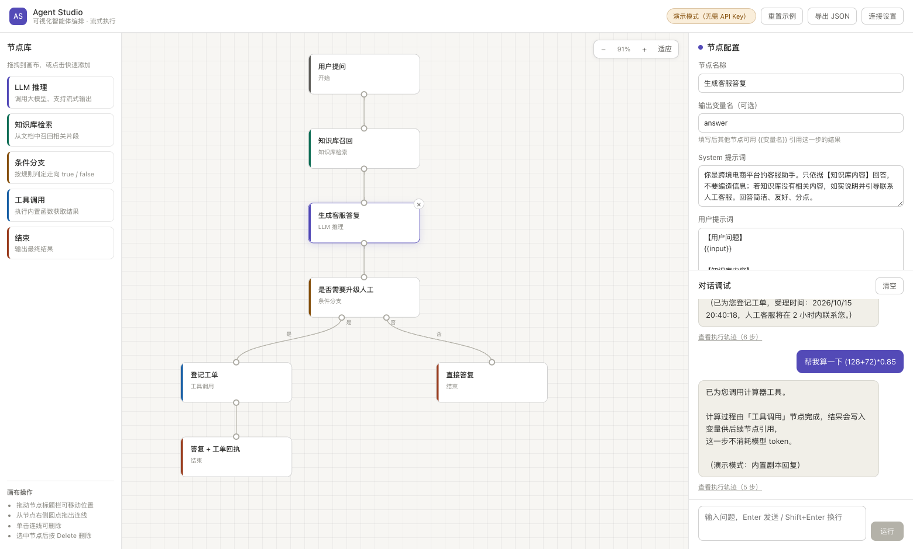

# Agent Studio

可视化智能体编排画布 + 流式对话的 AI 应用。画布、连线、执行引擎全部自研，未使用任何图形库。

**在线体验**：https://agent-studio-canvas.app.workbuddy.host/ （打开即用，无需 API Key）

**仓库**：https://github.com/7aniya/agent-studio

**技术文章**：《从零写一个可视化智能体编排引擎》—— 画布坐标系、自研执行引擎、SSE 流式链路、以及一次被截图逼出来的版式重构。全文见 [`docs/blog.md`](docs/blog.md)。



## 功能

- **拖拽编排**：从节点库拖出节点，从端口拖出连线，构建有向流程图
- **六类节点**：开始 / LLM 推理 / 知识库检索 / 条件分支（双出口）/ 工具调用 / 结束
- **流式执行**：逐节点高亮、逐 token 渲染、执行轨迹可展开查看每步输出与耗时
- **变量系统**：`{{input}}` `{{prev}}` 占位符插值，支持自定义 `outputKey` 做分支合并
- **内置工具**：获取当前时间、四则运算计算器、模拟联网搜索
- **本地检索**：bigram + IDF 加权的轻量召回，无外部依赖
- **演示模式**：未配置 Key 时走本地模拟，任何人打开都能看到完整链路

## 快速开始

```bash
npm install
npm start          # 构建并启动，访问 http://localhost:3000
```

开发模式（Vite HMR + 后端并行）：

```bash
npm run dev        # 前端 5173，后端 3000，/api 已配代理
```

其他命令：

```bash
npm run build      # 构建到 dist/
npm run typecheck  # TypeScript 类型检查
```

## 接入真实模型

界面右上角「连接设置」中填入：

| 字段 | 示例 |
| --- | --- |
| Base URL | `https://dashscope.aliyuncs.com/compatible-mode/v1` |
| API Key | `sk-...` |
| 模型 | `qwen-plus` / `deepseek-chat` / `gpt-4o-mini` |

任何 OpenAI 兼容接口均可。Key 仅存于浏览器 `localStorage`，随请求转发，服务端不留存、不打进前端产物。

## 项目结构

```
src/
  App.tsx                  状态编排、流程运行、设置持久化
  components/
    Canvas.tsx             画布：缩放、拖拽、连线、坐标换算
    NodeCard.tsx           节点卡片与端口
    Palette.tsx            节点库
    ConfigPanel.tsx        节点配置表单
    ChatPanel.tsx          对话与执行轨迹
  engine/
    runFlow.ts             有向图执行引擎、变量插值、分支判定
    retrieve.ts            bigram + IDF 轻量检索
    tools.ts               内置工具
  lib/
    llm.ts                 SSE 流式调用
    mock.ts                演示模式模拟引擎
    nodeMeta.ts            节点元信息、端口坐标、贝塞尔路径
    defaultFlow.ts         默认示例流程
server/
  index.js                 零依赖 Node 服务：静态托管 + SSE 代理
scripts/
  dev.js                    并行启动前后端
  smoke.py                  Playwright 端到端冒烟测试
docs/
  blog.md                   实现复盘：从画布坐标系到流式渲染
```

## 测试

```bash
npm run build && npm start          # 另开终端保持服务运行
python scripts/smoke.py             # 需先装 playwright
```

覆盖渲染、节点选中、执行、分支路由、控制台报错五项，并输出截图到 `docs/screenshot.png`。

## 实现复盘

画布坐标系、连线命中、流式渲染性能、以及一次被截图逼出来的版式重构，都记录在 [`docs/blog.md`](docs/blog.md)。
